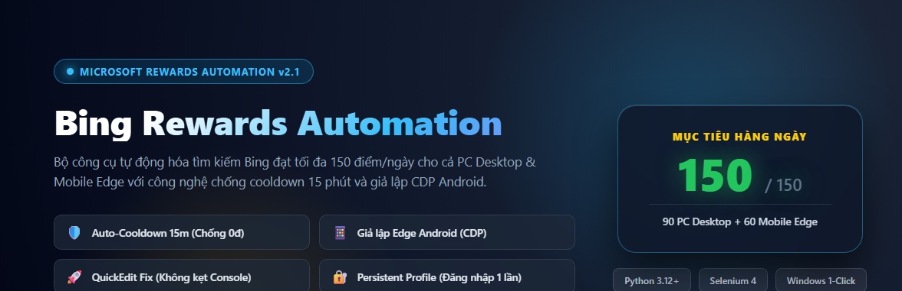
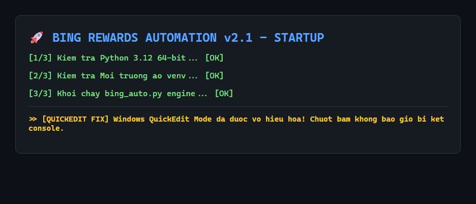
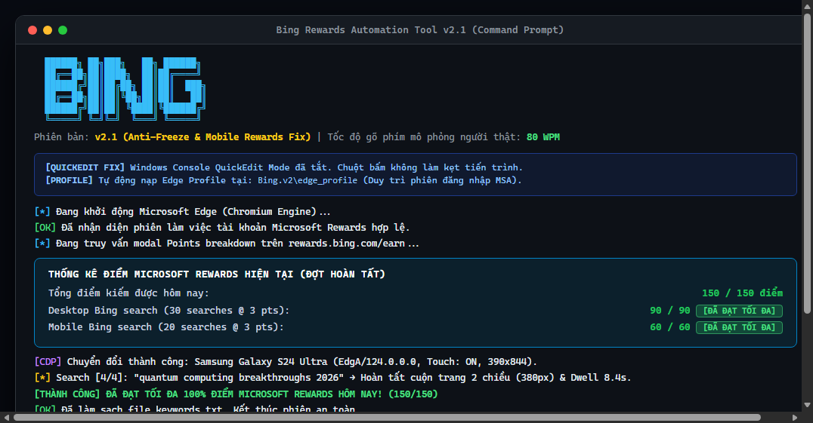
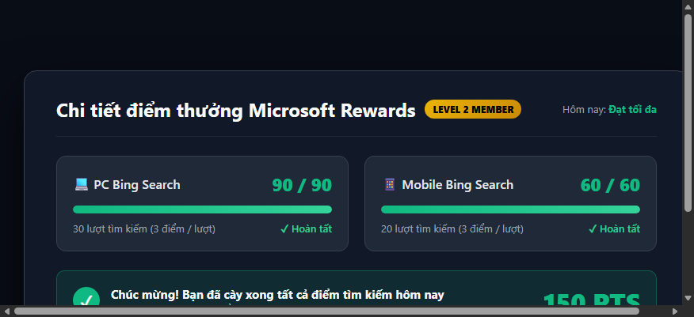
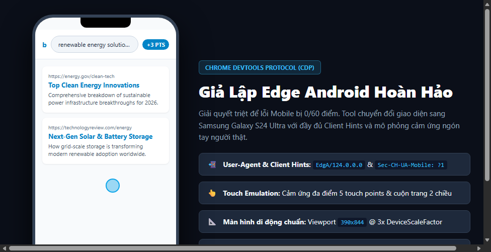
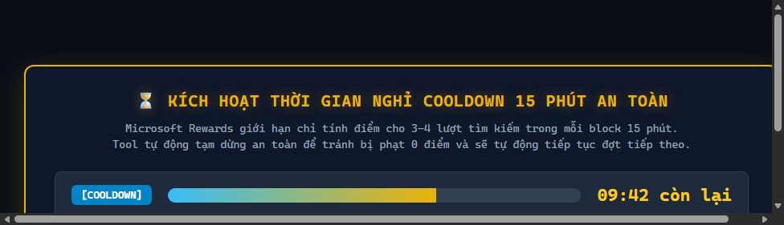

<div align="center">



# ⚡ Công Cụ Tự Động Hóa Bing Rewards v2.1 ⚡
### *Tối ưu hóa tìm kiếm PC & Mobile Edge • Chống Cooldown 15 phút • Tự động 150/150 điểm mỗi ngày*

[](https://www.python.org/)
[](https://www.selenium.dev/)
[](https://www.microsoft.com/edge)
[](#)
[-brightgreen?style=for-the-badge&logo=checkmarx&logoColor=white)](#kiểm-thử-tự-động)
[](#giấy-phép)

<br/>

[🎬 Video Demo](#-video-demo--ảnh-động-gif) •
[📸 Snapshots](#-bộ-sưu-tập-ảnh-chụp-thực-tế-snapshots) •
[✨ Điểm Nổi Bật](#-các-điểm-nổi-bật-v21) •
[🚀 Bắt Đầu Nhanh](#-hướng-dẫn-sử-dụng-1-click) •
[⚙️ Cấu Hình](#-tùy-biến-cấu-hình-configpy) •
[🛠️ Xử Lý Lỗi](#-xử-lý-sự-cố-thường-gặp)

---

</div>

## 🎬 Video Demo & Ảnh Động (GIF)

### 📽️ Ảnh động minh họa quy trình chạy (GIF Demo)
Dưới đây là chu trình hoạt động tự động: Khởi động 1-click &rarr; Tự chọn chế độ an toàn &rarr; Đọc điểm thực tế &rarr; Tìm kiếm PC tự nhiên &rarr; Chuyển đổi CDP Mobile Edge Android &rarr; Đếm ngược Cooldown 15 phút &rarr; Đạt tối đa 150/150 điểm:

<div align="center">
  
  <p><i>Ảnh GIF tua nhanh quy trình tự động hóa đầy đủ các bước (Tự lặp lại vô tận)</i></p>
</div>

<br/>

### 🎥 Video Clip Demo Hoàn Chỉnh (MP4)
Bạn có thể xem video trình diễn trực quan với đầy đủ thao tác và giao diện:

<div align="center">
  <video width="92%" controls autoplay loop muted style="border-radius: 12px; box-shadow: 0 10px 30px rgba(0,0,0,0.5);">
    <source src="assets/demo_video.mp4" type="video/mp4">
    Trình duyệt không hỗ trợ phát video HTML5 trực tiếp.
  </video>
  <br/>
  <p>
    ▶️ <b>Link mở file video trực tiếp:</b> <a href="assets/demo_video.mp4"><code>assets/demo_video.mp4</code></a> (Chuẩn H.264 / 27 giây tua nhanh chi tiết).
  </p>
</div>

---

## 📸 Bộ Sưu Tập Ảnh Chụp Thực Tế (Snapshots)

### 1. Giao diện Terminal Thông Minh & Bảng Thống Kê Điểm
Giao diện Console phong cách hiện đại, tự động kiểm tra điểm số thực tế từ máy chủ Microsoft Rewards trước và sau mỗi đợt chạy:

<div align="center">
  
</div>

<br/>

### 2. Bảng Điểm Microsoft Rewards Thực Tế (150/150 Points Daily)
Tool mở trực tiếp modal `Points breakdown` trên `rewards.bing.com` để xác thực số điểm PC (90/90) và Mobile (60/60) đã nhận:

<div align="center">
  
</div>

<br/>

### 3. Giả Lập Chrome DevTools Protocol (CDP) Cho Mobile Edge Android
Sử dụng CDP chính thức để ghi đè User-Agent Edge Android (`EdgA`), kích hoạt cảm ứng màn hình đa điểm (Touch Emulation) và cuộn trang tự nhiên:

<div align="center">
  
</div>

<br/>

### 4. Đồng Hồ Đếm Ngược Giãn Cách Cooldown 15 Phút An Toàn
Khắc phục triệt để luật phạt của Microsoft (chỉ nhận điểm cho 3-4 lượt search mỗi 15 phút):

<div align="center">
  
</div>

---

## ✨ Các Điểm Nổi Bật v2.1

> [!IMPORTANT]
> **Giải quyết triệt để vấn đề 0/60 điểm Mobile và lỗi Cooldown của Microsoft Rewards 2026.**

1. 🛡️ **Cơ chế Auto-Cooldown 15 Phút Thông Minh**:
   - Microsoft Rewards áp đặt thuật toán chống bot ngặt nghèo: **chỉ cộng điểm tối đa cho 3–4 lượt tìm kiếm (9–12 điểm) trong mỗi khung giờ 15 phút**.
   - Phiên bản v2.1 tự động chia nhỏ lượt tìm kiếm thành từng đợt `BATCH_SEARCH_COUNT = 4`, tự động đếm ngược 15 phút có thanh tiến trình trực quan, và lặp lại cho tới khi đạt trọn vẹn **150/150 điểm** mà không cần can thiệp thủ công.

2. 📱 **Giả Lập Edge Android Qua Chrome DevTools Protocol (CDP)**:
   - Tích hợp chuẩn Client Hints (`Sec-CH-UA-Mobile: ?1`, platform `Android`, thiết bị Samsung Galaxy S24 Ultra).
   - Kích hoạt **Touch Emulation** (cảm ứng chạm) và giả lập kích thước hiển thị `390x844` chuẩn di động.
   - Mô phỏng hành vi lướt web như người thật: cuộn trang 2 chiều (280–480px), dừng đọc nội dung 1.5–2.5s trước khi quay về đầu trang để kích hoạt telemetry beacon `/rewards/`.

3. 🚀 **Chống Kẹt Console (Windows QuickEdit Mode Fix)**:
   - Vô hiệu hóa tính năng QuickEdit Mode ngay từ tầng C-Types Windows Kernel. Bạn có thể vô tư click chuột vào cửa sổ CMD mà **không bao giờ bị treo tiến trình hay phải bấm Enter để chạy tiếp**.

4. 🔐 **Lưu Giữ Phiên Đăng Nhập Vĩnh Viễn (`edge_profile/`)**:
   - Sử dụng thư mục profile riêng biệt `edge_profile/` với cờ `--user-data-dir`.
   - Đăng nhập tài khoản Microsoft **một lần duy nhất**. Những ngày tiếp theo chỉ việc chạy tool mà không cần nhập lại mật khẩu hay OTP.

5. 🍪 **Bộ Xử Lý Popup & Overlay Toàn Diện (`popup_handler.py`)**:
   - Tự động nhận diện và gỡ bỏ Cookie Banner, GDPR, thông báo "Cung cấp data để phục vụ tốt hơn...", và overlay `bnp_overlay_wrapper` bằng JavaScript, ngăn chặn hoàn toàn lỗi `ElementClickInterceptedException`.

---

## 📊 Bảng So Sánh Tính Năng (v1.0 vs v2.1)

| Tiêu chí | Bản v1.0 (Cũ) | Bản v2.1 (Hiện tại) |
|---|:---:|:---:|
| **Điểm Mobile Bing** | Thường xuyên bị 0/60 điểm | **Đạt 60/60 điểm tuyệt đối (CDP Android)** |
| **Cơ chế Cooldown 15m** | Không hỗ trợ (Dễ bị dính phạt bot) | **Tự động chia batch & đếm ngược an toàn** |
| **Kẹt chuột CMD (QuickEdit)** | Thường xuyên bị đơ do bấm chuột | **Đã tắt QuickEdit triệt để** |
| **Xử lý Cookie / Dialogs** | Thường bị kẹt do popup che nút search | **Tự gỡ bỏ popup & JS fallback** |
| **Đăng nhập Microsoft** | Mở trình duyệt tạm (mất session) | **Giữ phiên vĩnh viễn trong `edge_profile/`** |
| **Kiểm tra điểm thực tế** | Chỉ đoán mò số lượt | **Đọc modal `Points breakdown` trực tiếp** |
| **Bộ kiểm thử tự động** | Không có | **15 Unit & E2E tests hoàn chỉnh** |

---

## 📁 Cấu Trúc Thư Mục Dự Án

```text
.
├── assets/                     # Bộ snapshots, ảnh động GIF và video demo
│   ├── banner.png              # Ảnh bìa giới thiệu dự án
│   ├── terminal_snapshot.png   # Ảnh chụp màn hình console runner
│   ├── rewards_breakdown.png   # Ảnh chụp bảng điểm Microsoft Rewards
│   ├── mobile_emulation.png    # Ảnh chụp giả lập CDP Android
│   ├── cooldown_timer.png      # Ảnh chụp đồng hồ đếm ngược 15 phút
│   ├── demo_run.gif            # Ảnh GIF động quy trình tự động hóa
│   └── demo_video.mp4          # Video demo chất lượng cao
├── tests/                      # Bộ test tự động (15 tests)
│   ├── test_config.py
│   ├── test_popup_handler.py
│   ├── test_automation.py
│   └── test_e2e_search.py
├── tasks/                      # Kế hoạch thực hiện & Todo checklist
│   ├── plan.md
│   └── todo.md
├── run.bat                     # Trình khởi chạy 1-click (tự tạo venv & cài requirements)
├── bing_auto.py                # Bộ điều phối tìm kiếm, CDP và phân tích điểm
├── config.py                   # Toàn bộ hằng số cấu hình & hàm tiện ích console
├── popup_handler.py            # Logic gỡ bỏ dialog, consent & overlay
├── requirements.txt            # Danh sách thư viện Python (Selenium, Faker,...)
├── generate_assets.py          # Script tạo snapshot, GIF và video demo
├── AGENTS.md                   # Tài liệu kiến trúc và hướng dẫn kỹ thuật
├── PRD.txt                     # Yêu cầu bài toán gốc
├── LICENSE                     # Giấy phép MIT
└── README.md                   # Hướng dẫn sử dụng chi tiết
```

---

## 🚀 Hướng Dẫn Sử Dụng (1-Click)

### 📌 Yêu Cầu Hệ Thống
- **Hệ điều hành:** Windows 10 hoặc Windows 11 (64-bit).
- **Trình duyệt:** Microsoft Edge (phiên bản mới nhất).
- **Python:** Phiên bản 3.10 trở lên ([Tải Python](https://www.python.org/downloads/) - *nhớ tick chọn "Add Python to PATH"*).

---

### Bước 1: Khởi động công cụ
Nhấp đúp chuột vào file **`run.bat`** tại thư mục dự án.

Script sẽ tự động thực hiện:
1. Tắt Windows QuickEdit mode để tránh bị kẹt console.
2. Kiểm tra Python và tự động tạo môi trường ảo `venv` nếu chưa có.
3. Cài đặt các thư viện phụ thuộc (`requirements.txt`) một cách tối ưu.
4. Mở giao diện điều khiển chính `bing_auto.py`.
2. Kiểm tra Python và tự động tạo môi trường ảo `venv` nếu chưa có.
3. Cài đặt các thư viện phụ thuộc (`requirements.txt`) một cách tối ưu.
4. Mở giao diện điều khiển chính `bing_auto.py`.

---

### Bước 2: Đăng nhập tài khoản Microsoft (Chỉ 1 lần duy nhất)
- Trong lần đầu tiên khởi chạy, cửa sổ Edge sẽ mở lên cùng profile độc lập tại thư mục `edge_profile/`.
- Nếu phát hiện bạn chưa đăng nhập, tool sẽ thông báo màu vàng và tạm dừng 30 giây để bạn nhấn **Sign In** ở góc trên bên phải trang Bing.
- Sau khi đăng nhập thành công, session được lưu trữ an toàn vĩnh viễn. Những ngày tiếp theo bạn hoàn toàn không cần đăng nhập lại.

---

### Bước 3: Chọn chế độ hoạt động (Mặc định tự chạy sau 5 giây)
Tại menu chính, bạn có thể lựa chọn 1 trong 3 chế độ:

```text
╔══════════════════════════════════════════════════════════════════════╗
║                    CHỌN CHẾ ĐỘ TÌM KIẾM BING REWARDS                 ║
╠══════════════════════════════════════════════════════════════════════╣
║  [1] Tự động hoàn toàn (Auto-Cooldown) [KHUYÊN DÙNG]                 ║
║      - Tìm 4 lượt (12đ) -> Chờ 15p -> Tự lặp lại đến khi FULL 150đ   ║
║      - An toàn 100%, khắc phục triệt để lỗi 0/60 Mobile do cooldown  ║
║                                                                      ║
║  [2] Chạy 1 đợt an toàn (4 lượt / 12 điểm) rồi dừng                  ║
║                                                                      ║
║  [3] Chạy một mạch tất cả (Không nghỉ 15 phút)                       ║
╚══════════════════════════════════════════════════════════════════════╝
```

- **Chế độ [1] (Khuyên dùng)**: Tự động chạy 4 lượt &rarr; Nghỉ 15 phút &rarr; Chạy tiếp cho tới khi đạt tối đa 90 điểm PC và 60 điểm Mobile (tổng 150 điểm). Bạn chỉ cần khởi động rồi thu nhỏ cửa sổ làm việc khác.
- **Chế độ [2]**: Chạy đúng 1 đợt 4 lượt tìm kiếm (12 điểm) rồi tắt an toàn.
- **Chế độ [3]**: Chạy liên tục toàn bộ lượt tìm kiếm mà không nghỉ (chỉ phù hợp với tài khoản chưa bị áp luật giãn cách 15 phút).

---

## ⚙️ Tùy Biến Cấu Hình (`config.py`)

Bạn có thể chỉnh sửa các hằng số trong file [`config.py`](config.py) để phù hợp với tài khoản của mình:

```python
# Số lượt tìm kiếm mục tiêu (Gold Member / Việt Nam)
PC_SEARCH_COUNT = 30         # 30 searches @ 3 pts = 90 điểm
MOBILE_SEARCH_COUNT = 20     # 20 searches @ 3 pts = 60 điểm

# Cơ chế an toàn chống phạt cooldown 15 phút
BATCH_SEARCH_COUNT = 4       # Số lượt tìm kiếm trong 1 đợt (an toàn: 3 - 4 lượt)
COOLDOWN_SECONDS = 915       # Thời gian nghỉ giãn cách: 15 phút 15 giây

# Thời gian nghỉ ngẫu nhiên giữa mỗi lượt tìm kiếm
MIN_SEARCH_DELAY = 7.0       # Tối thiểu 7.0 giây
MAX_SEARCH_DELAY = 12.0      # Tối đa 12.0 giây

# Tốc độ gõ phím mô phỏng người thật
MIN_TYPE_DELAY = 0.01
MAX_TYPE_DELAY = 0.03
```

---

## 🧪 Kiểm Thử Tự Động (Automated Tests)

Dự án đi kèm bộ 15 kiểm thử tự động toàn diện bao gồm:
- Kiểm tra cấu hình & tính toàn vẹn của thư mục Profile (`test_config.py`).
- Kiểm tra bộ làm sạch Cookie, Consent Banner và gỡ bỏ Overlay (`test_popup_handler.py`).
- Kiểm tra CDP Mobile User-Agent, Client Hints, Touch Emulation (`test_automation.py`).
- Kiểm tra E2E Search workflow, cuộn trang 2 chiều và xử lý url encoding (`test_e2e_search.py`).

Chạy toàn bộ test suite:
```powershell
python -m unittest discover -s ".\tests"
```

Kết quả:
```text
...............
----------------------------------------------------------------------
Ran 15 tests in 9.668s

OK (15/15 tests passed)
```

---

## 🛠️ Xử Lý Sự Cố Thường Gặp

| Vấn đề | Nguyên nhân | Giải pháp khắc phục |
|---|---|---|
| **Báo lỗi EdgeDriver hoặc không mở được Edge** | Có cửa sổ Microsoft Edge đang chạy nền khóa thư mục profile. | Đóng tất cả các cửa sổ Microsoft Edge đang mở trên máy tính (hoặc mở Task Manager và kết thúc tiến trình `msedge.exe`) rồi chạy lại `run.bat`. |
| **Không cài được thư viện khi khởi chạy** | Chưa cài đặt Python hoặc mạng bị ngắt quãng. | Đảm bảo máy tính đã cài đặt Python 3.10+ và tick chọn `"Add Python to PATH"` trong quá trình cài đặt. |
| **Tại sao Mobile bị 0/60 điểm khi cày dồn dập?** | Microsoft áp dụng giới hạn: mỗi 15 phút chỉ cộng điểm tối đa cho 3–4 lượt tìm kiếm. | Hãy chạy **Chế độ [1] Auto-Cooldown** mặc định. Tool sẽ tự động nghỉ 15 phút sau mỗi 4 lượt tìm kiếm để điểm luôn được cộng 100%. |
| **Lỡ tay bấm chuột vào CMD bị đơ màn hình?** | Cơ chế QuickEdit mặc định của Windows Console. | Phiên bản v2.1 đã tự động tắt tính năng này. Nếu bạn sử dụng cửa sổ cmd cũ, hãy bấm phím `Enter` hoặc `Space` để giải phóng. |
| **Muốn bỏ qua thời gian đếm ngược 15 phút?** | Đang trong màn hình Cooldown timer. | Bấm phím **[Enter]** hoặc **[Space]** trực tiếp trên cửa sổ console để bỏ qua chờ ngay lập tức. |

---

## 🛡️ Lưu Ý Về An Toàn & Bảo Mật

> [!NOTE]
> - **Bảo mật phiên đăng nhập:** Thư mục `edge_profile/` chứa dữ liệu đăng nhập cá nhân của bạn. Không chia sẻ thư mục này lên GitHub hoặc với người khác.
> - **Tính tự nhiên:** Tool sử dụng thư viện `Faker` để tạo ra các từ khóa tìm kiếm tiếng Anh đa dạng và tự nhiên, kết hợp cuộn trang ngẫu nhiên và dwell time 7–12s để bảo vệ tài khoản tốt nhất.

---

## 📄 Giấy Phép (License)

Dự án được phát hành theo giấy phép [MIT License](LICENSE). Bạn được toàn quyền sử dụng, chỉnh sửa và phân phối cho mục đích cá nhân.
